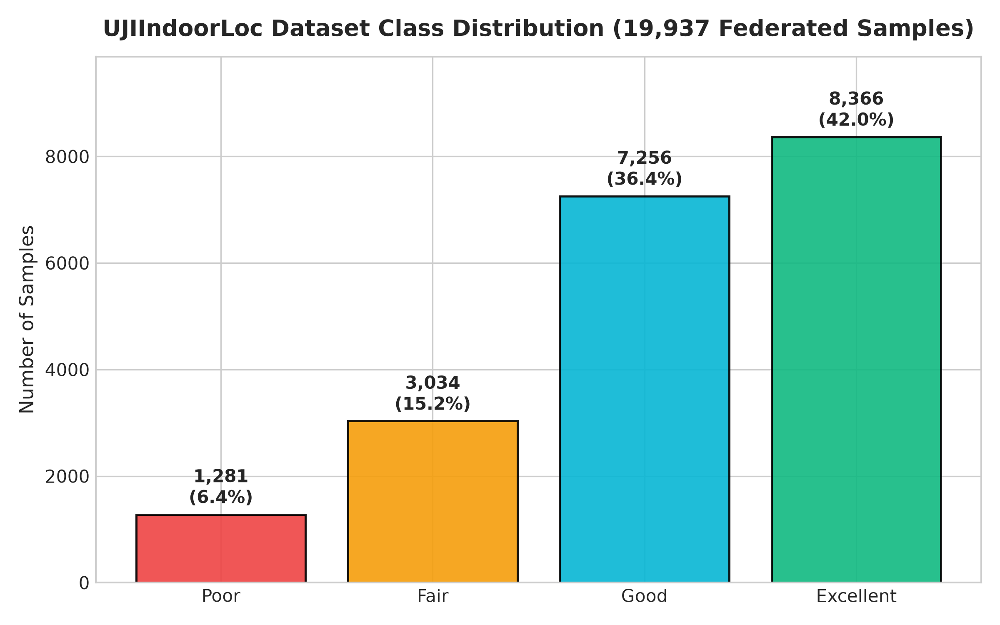
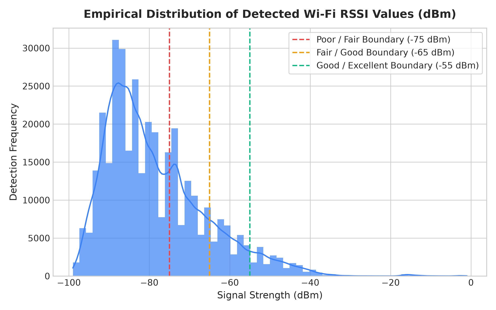
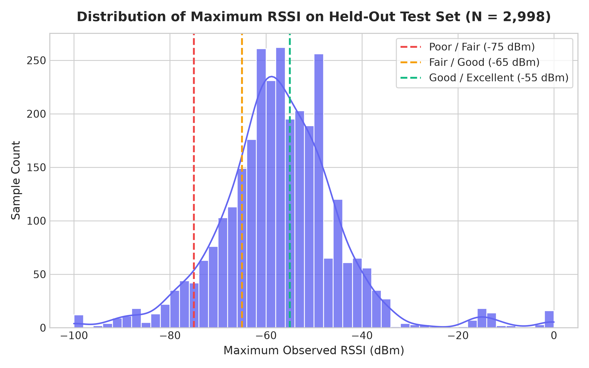
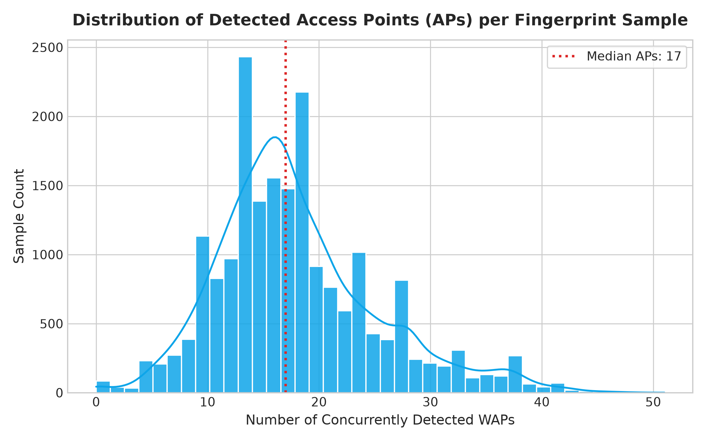
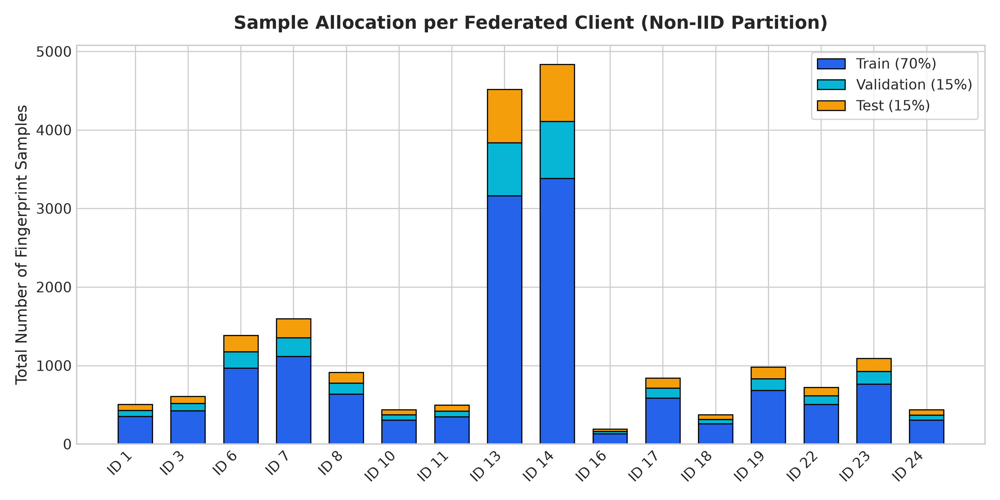
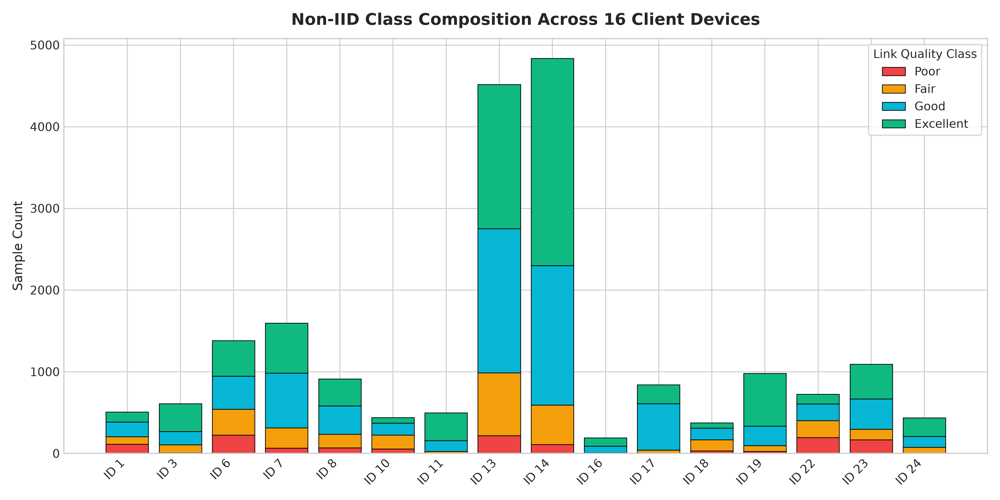

# Exploratory Data Analysis (EDA) Report

## 1. Purpose

Exploratory Data Analysis (EDA) helps us understand a dataset before training a machine-learning model. This report examines the Wi-Fi signal measurements used by the Personalized Federated Wireless project.

## 2. Dataset overview

The project uses the UJIIndoorLoc Wi-Fi fingerprint dataset. Each observation records received signal strength from Wi-Fi access points, along with location and device information.

The project uses the Wi-Fi signal measurements to classify connection quality as Poor, Fair, Good, or Excellent. The PHONEID field is also used to group observations into clients for the federated-learning experiments.

> Add the dataset source, exact number of rows, and the train/test split here. Use the values reported by your notebook or preprocessing code.

## 3. Data preparation

The preprocessing code handles missing access-point readings, removes access-point columns that do not vary, and creates summary features from the signal measurements. These include maximum and average RSSI, signal variation, and the number of detected access points.

> Confirm these details against your preprocessing code before submission.

## 4. Visual exploration

### 4.1 Class distribution

Describe which signal-quality classes have the most and fewest examples. Mention any class imbalance you observe.

### 4.2 RSSI distribution

Describe the range and shape of the RSSI values. RSSI is a measure of received signal strength; in this project, values closer to zero indicate stronger signals.

### 4.3 Maximum RSSI

Explain how the strongest detected access-point signal varies across observations.

### 4.4 Detected access points

Describe how many access points are typically detected for each observation.

### 4.5 Client sample distribution

Explain whether the observations are evenly distributed across clients. Differences matter because federated-learning clients may have different data amounts.

### 4.6 Client class distribution

Describe whether each client has a similar mix of signal-quality classes. Differences indicate that client data is not identically distributed.

## 5. Main observations

Write 3–5 observations based on the charts. For example:
- Which class is most common?
- Are some classes underrepresented?
- Do clients have noticeably different sample counts or class mixes?
- Are RSSI values spread across a wide range?

Only include statements supported by your charts or dataset analysis.

## 6. Conclusion

The EDA helps identify class balance, signal-strength patterns, and differences between client datasets. These observations inform the preprocessing and federated-learning experiments in the project.